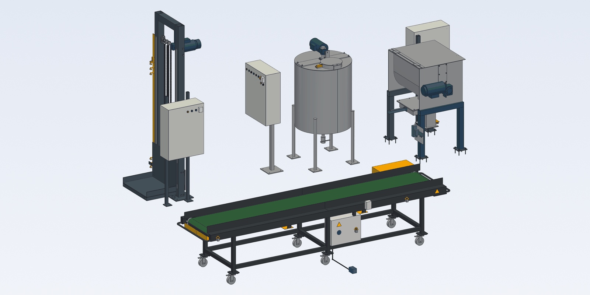
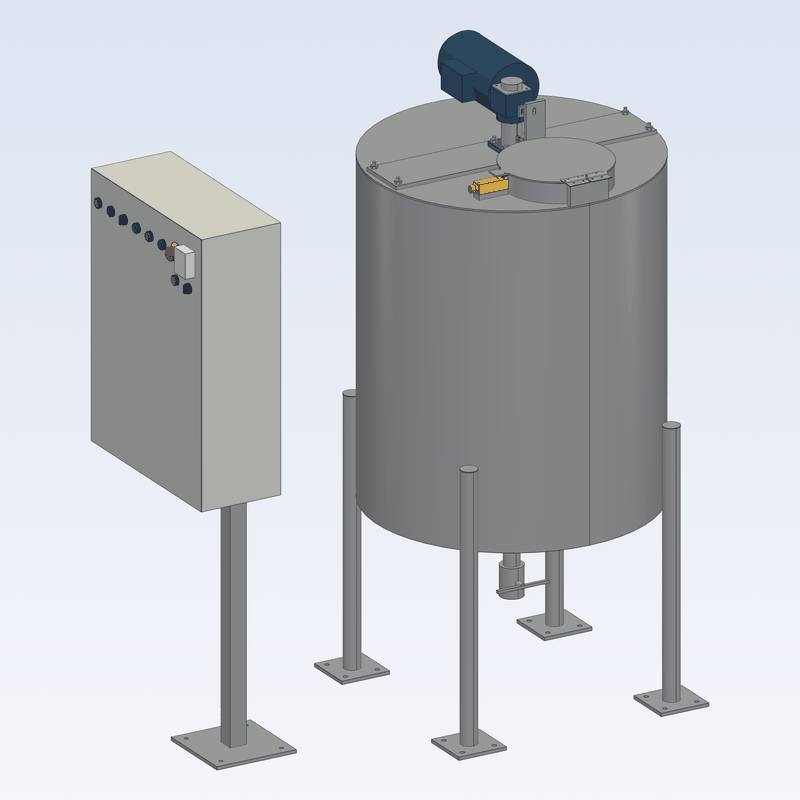
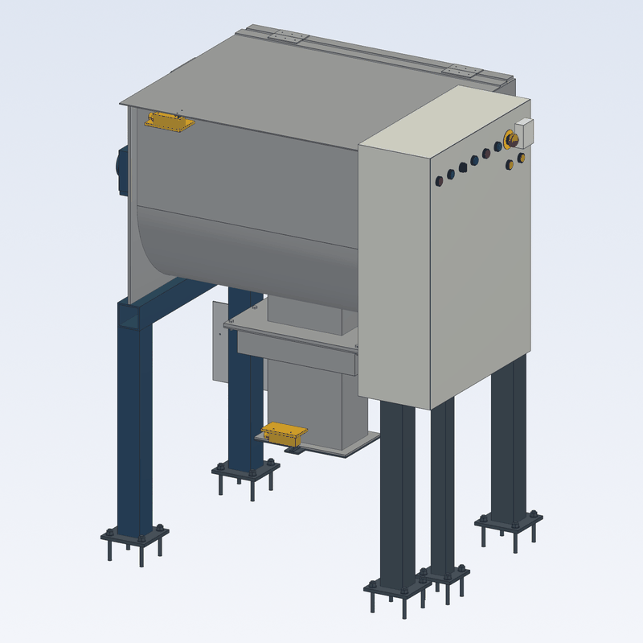
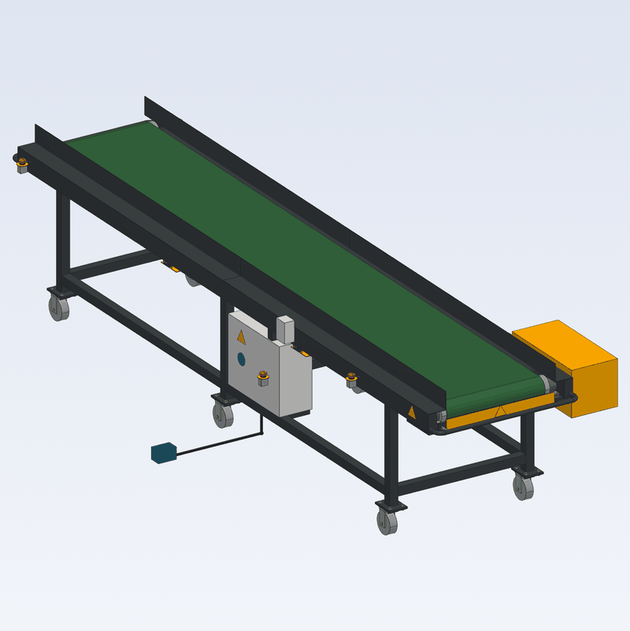
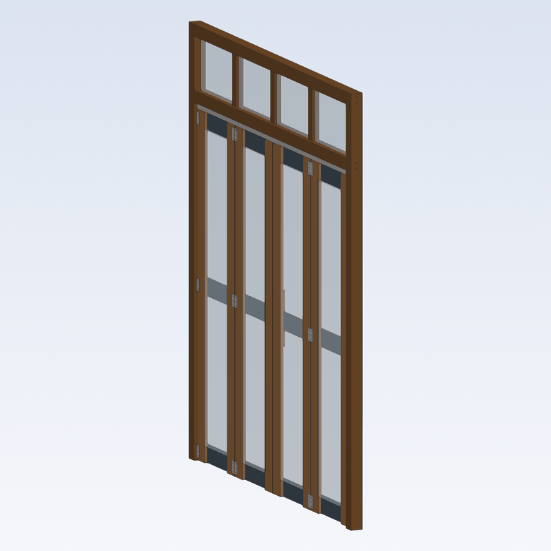
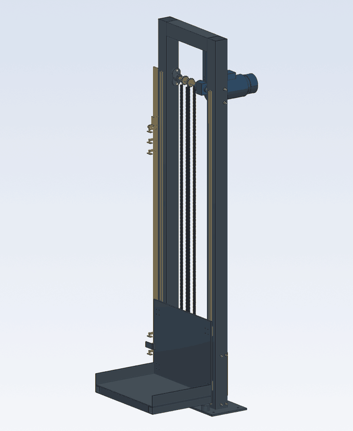
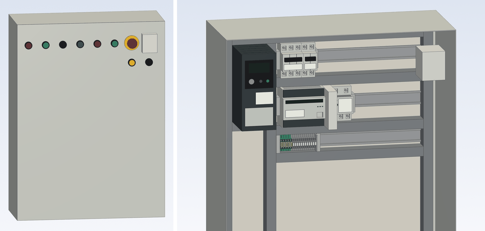
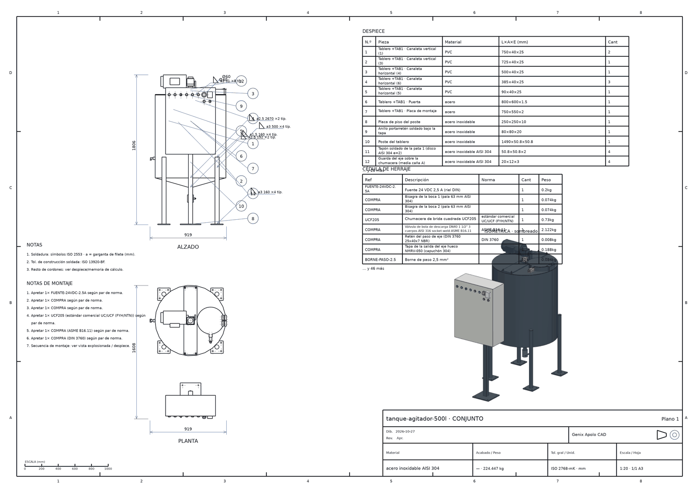

[English](README.md) · **Español**

<p align="center">
  
</p>

<h1 align="center">Genix Apolo CAD</h1>

<p align="center">
  <b>CAD paramétrico 3D para maquinaria industrial, hecho para que lo maneje un agente de IA.</b><br>
  El agente diseña como ingeniero por <b>MCP</b> y entrega lo terminado:
  el 3D validado, los planos de taller, la memoria de cálculo, la BOM con su costeo y el manual de montaje.
</p>

<p align="center">
  
  
  
  
  
</p>

---

## Qué es

Apolo es un CAD paramétrico headless (OpenCascade a través de build123d) con un servidor FastAPI
y un visor web en three.js. Toda operación es un comando contra una sola API HTTP, y el agente
de IA, la interfaz web y el servidor MCP son clientes iguales de esa API.

La meta no es tener los mismos botones que SolidWorks o Inventor. Esas herramientas están
pensadas para una persona que hace clic; Apolo está pensado para un agente que tiene que llegar
al mismo **resultado** que entrega un despacho de ingeniería competente:

- un 3D que se puede **fabricar y se sostiene** (sujeción, camino de carga, holguras y gravedad
  comprobados, no supuestos);
- **planos de taller**, una **memoria de cálculo** que cita sus normas, una **BOM con costeo y
  cotización** y un **manual de montaje** paso a paso;
- desde V8, el **tablero eléctrico, el programa del PLC y la neumática** de la máquina, probados
  en una puesta en marcha virtual antes de fabricar nada.

El agente trabaja con criterio de ingeniería por defecto: lo desmontable va atornillado, las
guardas se soportan y se fijan, y un diseño no se da por terminado mientras algo flote, choque o
no tenga su sujeción declarada.

## Velo

| | |
|---|---|
|  |  |
| **Tanque agitador de 500 L**: AISI 304, motorreductor, hélice de palas inclinadas, boca de inspección con enclavamiento y tablero con PLC, variador y relé de seguridad. Aprueba la puerta de publicación. | **Mezcladora de paletas de 200 L**: compuerta de descarga neumática (FRL, válvula 5/2, cilindro), enclavamientos de tapa y de recipiente, tablero con PLC. |
|  |  |
| **Faja de paquetería de 4 m**: el proyecto de referencia del benchmark, 100 % paramétrico. | **Puerta plegable**: madera y vidrio; el mismo motor fuera de la maquinaria. |

<table>
<tr>
<td width="40%"></td>
<td>
<b>Movimiento y física.</b> Un elevador de cajas de dos niveles (sin su cerramiento) corre su
estudio de movimiento: la plataforma cuelga de dos cadenas de rodillos amarradas en sus dos
extremos, y las cadenas la siguen en cada pose. Los estudios se revisan contra choques en todo el
recorrido; MuJoCo simula la gravedad, la prueba de caída y las juntas con motor, bandas y
sensores.
<br><br>
Todas las imágenes de esta página las renderiza Apolo, con el mismo motor con el que el agente
mira su propio trabajo (<code>render_view</code>, <code>motion_gif</code>, <code>drawing</code>).
</td>
</tr>
</table>

### El tablero, en 3D



El agente declara el circuito (aparatos con bornes, cables, conductores) y `layout_tablero` arma
el tablero: gabinete, rieles DIN, canaletas, aparatos y la puerta con sus mandos. Apolo corre la
revisión eléctrica (cortocircuitos, tensiones cruzadas, motores sin protección, puesta a tierra),
suma el tablero a la BOM y al costeo, y el programa del PLC corre contra los bornes reales.

## Lo que sale de un modelo



| Entregable | Qué trae |
|---|---|
| **Juego de planos** (PDF, DXF; DWG con ODA) | Lámina de conjunto con despiece y globos, una lámina por pieza con callouts de agujeros, ajustes ISO 286, datums y GD&T, ISO 2768-mK, rugosidad ISO 1302, soldadura ISO 2553, lista de corte, cédula de herraje y lámina de instalación con la carga por anclaje |
| **Memoria de cálculo** (PDF A4) | Bases de diseño, fórmula, sustitución y factor de seguridad de cada verificación, cada una con su norma (CEMA, ISO, DIN, EN, AISC), y resultados de FEA con su convergencia de malla |
| **BOM, costeo y cotización** | Lista de materiales (mecánica, eléctrica y neumática), lista de corte, nesting y una cotización donde cada costo dice de dónde sale |
| **Manual de montaje** | Pasos ordenados por el camino de carga, de abajo arriba, con el par de apriete y la llave de cada paso |
| **Esquema neumático** | Lámina ISO 1219 generada del circuito de aire declarado ([ejemplo](docs/readme/esquema-neumatico.png)) |
| **Validación** | Interferencias, gravedad y estabilidad, cadenas de cotas (peor caso y RSS), FEA estático lineal y dos puertas: `delivery_check` (verde / amarillo / rojo) y la más exigente `publication_gate` |

## Para empezar

```bash
pip install "apolo-cad[physics,fea]"   # extras: física MuJoCo y FEA estático lineal
apolo --open                            # API + interfaz web en http://127.0.0.1:8000
```

Python 3.11–3.13; el CI corre en Linux y Windows. Tus proyectos se guardan en `~/.apolo/`
(`APOLO_HOME` lo cambia). `apolo-cad[sketch]` fuerza el solver de croquis PlaneGCS donde no hay
wheel publicado; si no, el croquis usa el motor de SciPy.

### Conecta un agente por MCP

Deja `apolo` corriendo y registra el servidor stdio en cualquier cliente MCP (Claude Code,
Claude Desktop, …):

```jsonc
{
  "mcpServers": {
    "apolo-cad": {
      "command": "apolo-mcp",
      "env": { "APOLO_URL": "http://127.0.0.1:8000" }
    }
  }
}
```

El servidor también figura en el registro oficial de MCP como `io.github.mariorojasmz/apolo-cad`.
Después pide en lenguaje natural:

> *«Diseña una faja de 4 m × 600 mm para paquetes de 1 a 15 kg, con motorreductor de eje hueco y
> un tablero con paro de emergencia. Revisa que nada choque ni se caiga y dame el juego de
> planos y la memoria de cálculo.»*

El agente trabaja en un ciclo: **modela** con `run_batch` (lotes atómicos: una regeneración, un
paso de undo, con un contrato opcional que revierte el lote entero si falla una holgura o una
interferencia), **mira** con `render_view` y `measure`, **valida** con `check_interference`,
`gravity_test`, `engineering_check` y `delivery_check`, y **documenta** con `drawing_set`,
`calc_report`, `quotation` y `assembly_manual`.

El núcleo de escritura es chico (`run_command`, `run_batch`, `edit_command`, `edit_batch`,
undo/redo) y cubre todo el registro de comandos; el resto de las 92 tools lee, mide, simula y
produce documentos. Todo lo que hace el agente es un comando del log: editable, deshacible y
visible en vivo en el navegador.

## Cómo funciona

```
   agente IA (MCP) ──┐        ┌── interfaz web (React + three.js)   clientes iguales
                     ▼        ▼                                     de una API HTTP
                core/apolo/api      FastAPI · REST + WebSocket · jobs
                     │
   doc        documento = log de comandos (event-sourced, undo/redo, .apolo de KB)
   commands   registro de comandos + JSON Schemas: UI, diálogos y tools del agente de una fuente
   kernel     build123d / OpenCascade: B-rep, render, medición, picking
   library    catálogo por normas, BOM, costeo, reglas de ingeniería
   assembly   juntas, mates, restricciones, conectividad
   drawing    planos HLR, juego de planos, memoria de cálculo, manual
   physics    MuJoCo: gravedad, caída, dinámica                fea   gmsh + scikit-fem
   plc        Texto Estructurado compilado a Python seguro     cosim eléctrica + PLC + mecánica
```

- **El documento es un log de comandos.** La geometría nunca se guarda: abrir un archivo es
  reproducir su log, así que los archivos pesan KB y cualquier comando pasado sigue editable.
- **Schema-driven.** Un comando que entra al registro aparece en la barra, los diálogos, el
  panel de propiedades y las tools del agente sin escribir nada más.
- **Expresiones en todo.** Cualquier campo numérico acepta `"=expresión"` con las variables del
  proyecto; cambiar una variable regenera el modelo.
- **Selectores declarativos** de aristas y caras (dirección, cara, longitud, cercanía) en vez de
  nombres topológicos frágiles.
- **Las plantillas de máquina son super-comandos** (`create_belt_conveyor`,
  `create_roller_conveyor`, `create_hoist_chain`, `create_pneumatic_cylinder`, `layout_tablero`,
  …): heredan la edición paramétrica, el undo, la BOM y la exposición al agente.
- **Un catálogo de 469 referencias** con medidas de norma (ISO, DIN, EN, ASTM): rodamientos,
  perfiles, tornillería, motorreductores, aparatos eléctricos y neumáticos.

## La máquina viva (V8)

La hoja de ruta actual le da a cada máquina su control real:

- **Modelo eléctrico**: aparatos con bornes, cables y conductores; revisión eléctrica (ERC); BOM
  y costeo eléctricos.
- **Tablero en 3D**: rieles, canaletas, aparatos y puerta, largo de cada cable, llenado de
  canaletas, calentamiento (IEC 60890) y prensaestopas.
- **PLC**: el programa se escribe en Texto Estructurado (IEC 61131-3) y se compila a un ciclo de
  scan seguro y determinista, con watchdog.
- **Co-simulación**: la red alimenta el tablero, el PLC lee los sensores y manda contactores y
  variadores, los motores mueven la física de MuJoCo y cada escenario de prueba sale verde o
  rojo. En el visor aprietas los botones del tablero y ves cómo responde la máquina.
- **Neumática**: FRL, válvulas, cilindros y mangueras; el cilindro empuja con su fuerza, su
  velocidad por caudal y el aire que consume; esquema ISO 1219.

## Estado

V1–V7 están cerradas: modelado, ensamblajes, planos, entregables, robustez y rendimiento.
**V8, la máquina viva, está en curso**: el modelo eléctrico, la física, la co-simulación y el
visor en vivo están hechos; el tablero en 3D, la neumática y la cadena de izaje se están
completando. El detalle, en la [hoja de ruta](docs/roadmap.md).

La madurez se mide por entregables, no por funciones: el paquete de Apolo de una máquina se
califica contra el mismo paquete terminado a mano, con una rúbrica pública
([benchmark](docs/benchmark/README.md)).

Antes de entregar una máquina, un segundo agente la revisa a ciegas con una lista de taller
([prompt del revisor](docs/revisor-de-taller.md)); cada defecto confirmado se vuelve una regla.

Fuera de alcance a propósito: CAM, FEA de contacto o no lineal, nube multiusuario y diseño
generativo.

## Desde el código fuente

```powershell
python -m venv .venv
.venv\Scripts\python -m pip install -e "core[dev,physics,fea]"
cd ui ; npm ci ; npm run build ; cd ..
.\start-apolo.ps1                                   # API + UI en http://127.0.0.1:8000
.venv\Scripts\python -m pytest tests -q -n auto    # 6641 tests
```

El repo trae un `.mcp.json` para el checkout. La interfaz web también tiene un chat integrado
opcional, apagado por defecto (`APOLO_CHAT=1` y `ANTHROPIC_API_KEY`).

## Contribuir

Las contribuciones son bienvenidas. Lee primero [CONTRIBUTING.md](CONTRIBUTING.md): qué se
acepta, cómo correr los tests y el build, y el estilo de commits. En tu primer pull request se
te pedirá firmar una vez el [Acuerdo de Licencia de Contribuidor](docs/CLA.md), con CLA
Assistant. Para reportar un problema de seguridad, sigue [SECURITY.md](SECURITY.md).

## Licencia

[MIT](LICENSE) © 2026 Mario Rojas.

Construido sobre software libre: [OpenCascade](https://www.opencascade.com/) (LGPL),
[build123d](https://github.com/gumyr/build123d) (Apache-2.0),
[FastAPI](https://fastapi.tiangolo.com/) (MIT), [three.js](https://threejs.org/) (MIT),
[MuJoCo](https://mujoco.org/) (Apache-2.0), [gmsh](https://gmsh.info/) (GPL, extra opcional
`fea`) y [scikit-fem](https://github.com/kinnala/scikit-fem) (BSD).
